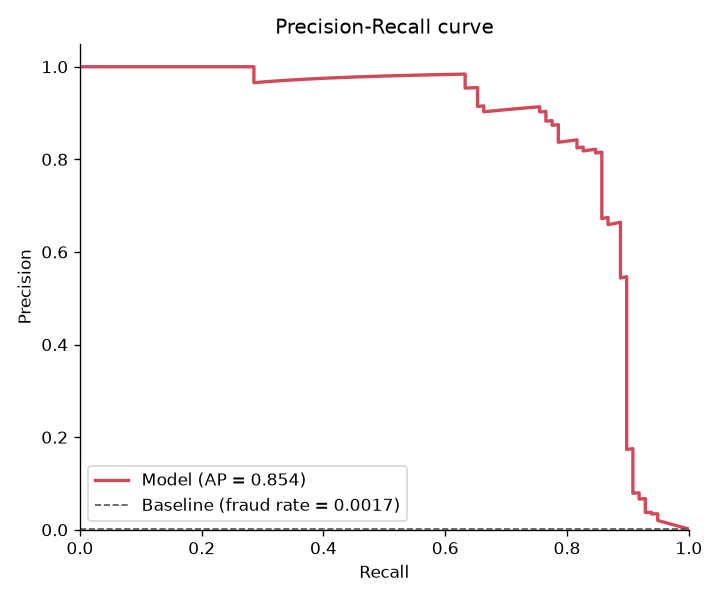

# Credit Card Fraud Detection

## Summary

Personal machine learning project focused on financial fraud detection. A Random Forest
classifier is trained to flag fraudulent credit card transactions in a highly imbalanced
dataset (about 0.17% fraud). Hyperparameters are tuned with Optuna to maximize PR-AUC,
and the decision threshold is chosen with cross-validation on the training data.

This is a learning project, not a production system. The current results are
**preliminary**: the model was tuned with only 3 Optuna trials and will be retrained and
tested more thoroughly later.

## Dataset

[Credit Card Fraud Detection](https://www.kaggle.com/datasets/mlg-ulb/creditcardfraud)
from Kaggle (`mlg-ulb/creditcardfraud`):

- 284,807 transactions made by European cardholders over two days in September 2013.
- 492 frauds (about 0.17% of all transactions).
- Features `V1`-`V28` are the result of a PCA transformation; the original features are
  not available for confidentiality reasons. `Time` (seconds since the first transaction)
  and `Amount` are not transformed. The target is `Class` (1 = fraud, 0 = legitimate).
- License: [Database Contents License (DbCL) v1.0](https://opendatacommons.org/licenses/dbcl/1-0/).

The dataset is not included in this repository. Download `creditcard.csv` from Kaggle and
place it in `data/raw/`.

**Citation:**

> Andrea Dal Pozzolo, Olivier Caelen, Reid A. Johnson and Gianluca Bontempi.
> *Calibrating Probability with Undersampling for Unbalanced Classification.*
> In Symposium on Computational Intelligence and Data Mining (CIDM), IEEE, 2015.

## Approach

- **Features:** `Amount` is replaced by `Amount_log = log1p(Amount)` and `Time` by
  `Hour = (Time // 3600) % 24` (hour relative to the first transaction). `V1`-`V28` are
  used as they are. Each new feature uses only its own row, so there is no leakage.
- **Split:** stratified 80/20 train/test split with a fixed seed. The test set is used
  only once, for the final evaluation.
- **Class imbalance:** handled with `class_weight="balanced_subsample"` in the Random
  Forest, with no resampling. Accuracy is not used, because always predicting
  "legitimate" would already score about 99.8%.
- **Tuning:** Optuna (TPE sampler, fixed seed) maximizes PR-AUC (average precision),
  computed from stratified 3-fold out-of-fold predictions on the training set. Search
  space: `n_estimators` 100-400, `max_depth` 6-24, `min_samples_leaf` 1-10,
  `max_features` in {`sqrt`, `log2`, 0.3}.
- **Threshold:** chosen to maximize F1 on stratified 5-fold out-of-fold probabilities on
  the training set, never on the test set.
- **Final model:** trained on the full training set with the best parameters.

## Results

Evaluated on the held-out test set: 56,962 transactions, 98 of them fraud (fraud rate
0.0017).

> **Preliminary results.** Tuned with only 3 Optuna trials; these numbers may change
> after more thorough tuning and testing.

**PR-AUC (average precision)**

| Model | PR-AUC |
|---|---|
| Random baseline (≈ fraud rate) | 0.0017 |
| **Random Forest** | **0.854** |

**Random Forest at two thresholds**

| Threshold | Precision | Recall | F1 | TP | FP | FN | TN |
|---|---|---|---|---|---|---|---|
| 0.5 (default) | 0.833 | 0.816 | 0.825 | 80 | 16 | 18 | 56,848 |
| 0.4525 (chosen via CV) | 0.822 | 0.847 | 0.834 | 83 | 18 | 15 | 56,846 |

At the chosen threshold, the model detects 83 of the 98 frauds in the test set and
raises 18 false alarms out of 56,864 legitimate transactions.

**Model parameters:** `n_estimators=117`, `max_depth=22`, `min_samples_leaf=7`,
`max_features=0.3`, `class_weight="balanced_subsample"`.



## How to run

```bash
# 1. Create a virtual environment and install the dependencies
python -m venv .venv
source .venv/bin/activate        # Windows (Git Bash): source .venv/Scripts/activate
pip install -r requirements.txt

# 2. Download creditcard.csv from Kaggle into data/raw/

# 3. Run the tests
pytest

# 4. Tune, choose the threshold and train the final model -> models/model.joblib
python -m src.train --trials 20

# 5. Evaluate on the test set -> reports/metrics.json and reports/pr_curve.png
python -m src.evaluate

# 6. (Optional) Publish to the Hugging Face Hub (requires `hf auth login`)
python -m src.publish --repo your-username/credit-card-fraud-rf
```

The notebooks in `notebooks/` contain the data exploration and the model comparison.

## How to use the model

> `model.joblib` is a pickle-based file. Loading a pickle can run arbitrary code, so
> only load files from sources you trust.

```python
import joblib
import numpy as np
import pandas as pd
from huggingface_hub import hf_hub_download

path = hf_hub_download(repo_id="guilhermedaros/credit-card-fraud-rf", filename="model.joblib")
bundle = joblib.load(path)

model = bundle["model"]          # fitted RandomForestClassifier
threshold = bundle["threshold"]  # decision threshold chosen via CV
features = bundle["features"]    # expected column order

# `df` must have the original columns: Time, V1..V28, Amount
df = pd.read_csv("transactions.csv")
X = df.drop(columns=["Time", "Amount"], errors="ignore").assign(
    Amount_log=np.log1p(df["Amount"]),
    Hour=(df["Time"] // 3600 % 24).astype(int),
)[features]

proba = model.predict_proba(X)[:, 1]
is_fraud = proba >= threshold
```

The model was trained with scikit-learn; use a compatible version (see `requirements.txt`).

## Project structure

```
├── data/raw/            # creditcard.csv (not versioned)
├── models/              # model.joblib (not versioned)
├── notebooks/
│   ├── 01_exploration.ipynb
│   └── 02_modeling.ipynb
├── reports/             # metrics.json, pr_curve.png
├── src/
│   ├── config.py        # paths and constants
│   ├── data.py          # load_data, split_data
│   ├── features.py      # add_features
│   ├── train.py         # baseline, Random Forest, Optuna tuning, threshold, main
│   ├── evaluate.py      # metrics, PR curve, main
│   └── publish.py       # upload to the Hugging Face Hub
├── tests/
│   └── test_pipeline.py
├── requirements.txt
└── LICENSE
```

## Limitations

- **Anonymized features:** `V1`-`V28` are PCA components, so the model cannot be
  interpreted in terms of real transaction attributes, and it cannot be applied to data
  that was not transformed in the same way.
- **Narrow time window:** the data covers only two days of September 2013 from European
  cardholders. Fraud patterns change over time, so performance on newer or different
  data is unknown.
- **Random split may be optimistic:** the train/test split is random, not by time. In a
  real setting the model would predict future transactions. The dataset also has 1,081
  duplicate rows that were not removed, so copies may appear in both train and test.
- **Few frauds, high variance:** the test set has only 98 frauds, so each one changes
  recall by about 1 point. The metrics have noticeable uncertainty.
- **Limited tuning:** only 3 Optuna trials were run.
- **No calibration and no fairness analysis:** the predicted probabilities are not
  calibrated and should not be read as true fraud probabilities. No fairness or bias
  analysis was done.
- **Not for production use:** this is a personal learning project. Do not use it to make
  real decisions about transactions or customers.

## License

The code and model in this repository are released under the MIT License. See
[LICENSE](LICENSE). The dataset is licensed separately under the DbCL v1.0.
