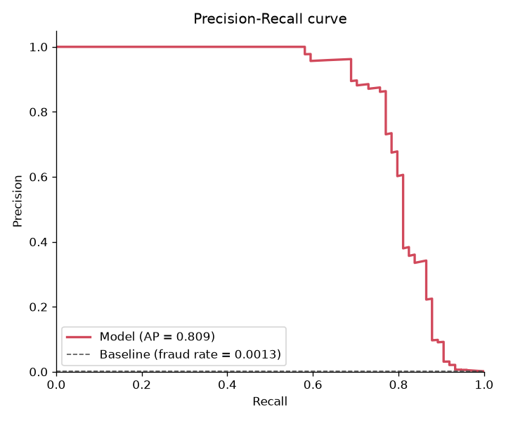

# Credit Card Fraud Detection

[](https://github.com/guiDaros/credit-card-fraud-detection/actions/workflows/ci.yml)

Code: [github.com/guiDaros/credit-card-fraud-detection](https://github.com/guiDaros/credit-card-fraud-detection)

## Summary

Personal machine learning project on credit card fraud detection. A Random Forest flags
fraudulent transactions in a highly imbalanced dataset (about 0.17% fraud). The saved model
is a scikit-learn pipeline that takes the raw columns, computes its own features and
returns a fraud score; a decision threshold chosen on the training data turns the score
into a fraud / not-fraud flag.

The main evaluation uses a **temporal split**: the model is trained on the past and tested
on the most recent 20% of the transactions. On that test set it reaches a PR-AUC of
**0.809** (95% bootstrap interval 0.729-0.892), detecting 57 of 74 frauds with 16 false
alarms among 56,670 legitimate transactions. The test set is small in frauds, so these
numbers are uncertain.

This is a learning project, not a production system.

## Dataset

[Credit Card Fraud Detection](https://www.kaggle.com/datasets/mlg-ulb/creditcardfraud)
from Kaggle (`mlg-ulb/creditcardfraud`):

- Transactions made by European cardholders over two days in September 2013.
- Features `V1`-`V28` are the result of a PCA transformation; the original features are
  not available for confidentiality reasons. `Time` (seconds since the first transaction)
  and `Amount` are not transformed. The target is `Class` (1 = fraud, 0 = legitimate).
- License: [Database Contents License (DbCL) v1.0](https://opendatacommons.org/licenses/dbcl/1-0/).

From `reports/data_report.json`:

| | Rows | Frauds | Fraud rate |
|---|---|---|---|
| Raw `creditcard.csv` | 284,807 | 492 | 0.173% |
| After removing exact duplicates | 283,726 | 473 | 0.167% |

- **Duplicates removed:** 1,081 exact duplicate rows (19 of them frauds).
- **sha256 of `creditcard.csv`:**
  `76274b691b16a6c49d3f159c883398e03ccd6d1ee12d9d8ee38f4b4b98551a89`

The dataset is not included in this repository. Download `creditcard.csv` from Kaggle and
place it in `data/raw/`. You can check that you have the same file with
`sha256sum data/raw/creditcard.csv`.

**Citation:**

> Andrea Dal Pozzolo, Olivier Caelen, Reid A. Johnson and Gianluca Bontempi.
> *Calibrating Probability with Undersampling for Unbalanced Classification.*
> In Symposium on Computational Intelligence and Data Mining (CIDM), IEEE, 2015.

## Approach

- **Data cleaning** (`src/make_dataset.py`): the raw CSV is validated with a pandera
  schema, exact duplicate rows are removed, and the data is sorted by `Time`.
- **Pipeline with packaged features:** the saved model is a scikit-learn `Pipeline`:
  1. a feature step that adds `Amount_log = log1p(Amount)` and, optionally,
     `Hour = (Time // 3600) % 24` (hour relative to the first transaction), then drops
     `Time` and `Amount`;
  2. a Random Forest.

  The pipeline takes the raw columns (`Time`, `V1`-`V28`, `Amount`), so users do not need
  to recreate the features, and the features are computed inside each cross-validation
  fold. `--no-hour` trains a model without `Hour`.
- **Split** (`--split`, default `temporal`):
  - `temporal`: rows up to the 80% quantile of `Time` are train, later rows are test.
  - `random`: stratified random 80/20 split with a fixed seed.

  The test set is used only once, for the final evaluation.
- **Class imbalance:** `class_weight="balanced_subsample"` in the Random Forest, no
  resampling. Accuracy is not used, because always predicting "legitimate" would already
  score about 99.8%.
- **Tuning:** Optuna (TPE sampler, fixed seed, 20 trials) maximizes PR-AUC (average
  precision) on out-of-fold predictions from the training set. Search space:
  `n_estimators` 100-400, `max_depth` 6-24, `min_samples_leaf` 1-10, `max_features` in
  {`sqrt`, `log2`, 0.3}.
- **Temporal validation:** with the temporal split, out-of-fold predictions come from a
  forward-in-time split (`TimeSeriesSplit`): each fold is trained on the past and predicts
  the next block; the first block is never scored. With the random split, stratified
  K-fold is used.
- **Threshold:** chosen to maximize F1 on the out-of-fold probabilities of the training
  set (5 folds), never on the test set, and stored in the model file.
- **Final model:** refit on the full training set with the best parameters.

## Results

Source: `reports/metrics_*.json`, with the 95% confidence intervals computed in
[`notebooks/03_split_comparison.ipynb`](notebooks/03_split_comparison.ipynb) (percentile
bootstrap of the test set, 1,000 resamples). Precision, recall and F1 use the threshold
chosen by cross-validation.

| Configuration | PR-AUC [95% CI] | Precision [95% CI] | Recall [95% CI] | F1 [95% CI] | Test frauds | Fraud rate train / test |
|---|---|---|---|---|---|---|
| random | 0.803 [0.722, 0.881] | 0.959 [0.913, 1.000] | 0.747 [0.660, 0.828] | 0.840 [0.777, 0.895] | 95 | 0.167% / 0.167% |
| **temporal** | **0.809** [0.729, 0.892] | 0.781 [0.687, 0.875] | 0.770 [0.672, 0.870] | 0.776 [0.702, 0.848] | 74 | 0.176% / 0.130% |
| temporal, no `Hour` | 0.816 [0.735, 0.899] | 0.864 [0.776, 0.944] | 0.770 [0.672, 0.870] | 0.814 [0.742, 0.883] | 74 | 0.176% / 0.130% |

What the comparison shows (notebook 03):

- **Random vs temporal:** the PR-AUC intervals overlap, so this run does not show the
  random split overestimating performance. The two are evaluated on different test sets,
  so this is only a rough comparison.
- **Effect of `Hour`** (same test rows, paired bootstrap of temporal minus no-`Hour`):
  PR-AUC difference -0.007 [-0.019, +0.004], within the noise; F1 difference -0.039
  [-0.070, -0.013], so the model without `Hour` is slightly better at its chosen
  threshold. `Hour` does not help on this data.

Details of the temporal model (`reports/metrics_temporal.json`):

- **Train:** 226,982 transactions, 399 frauds. **Test:** 56,744 transactions, 74 frauds.
- **Threshold:** 0.5222. At this threshold: 57 frauds caught, 17 missed, 16 false alarms,
  56,654 correct "legitimate".
- **Parameters:** `n_estimators=121`, `max_depth=21`, `min_samples_leaf=9`,
  `max_features="sqrt"`, `class_weight="balanced"`.
- The fraud rate is lower in the test period (0.130%) than in training (0.176%).



## Precision/recall trade-off

Temporal model, test set, from notebook 03. False alarms per 10,000 counts all test
transactions.

| Threshold | Precision | Recall | Frauds caught | False alarms | False alarms per 10k |
|---|---|---|---|---|---|
| 0.1 | 0.208 | 0.878 | 65 / 74 | 248 | 43.71 |
| 0.2 | 0.432 | 0.811 | 60 / 74 | 79 | 13.92 |
| 0.3 | 0.634 | 0.797 | 59 / 74 | 34 | 5.99 |
| 0.4 | 0.699 | 0.784 | 58 / 74 | 25 | 4.41 |
| 0.5 | 0.770 | 0.770 | 57 / 74 | 17 | 3.00 |
| 0.6 | 0.862 | 0.757 | 56 / 74 | 9 | 1.59 |
| 0.7 | 0.911 | 0.689 | 51 / 74 | 5 | 0.88 |
| 0.8 | 0.961 | 0.662 | 49 / 74 | 2 | 0.35 |
| 0.9 | 1.000 | 0.568 | 42 / 74 | 0 | 0.00 |

This table is descriptive only: it is computed on the test set, so it was not used to
choose the threshold (0.5222, chosen on the training data). Neighbouring rows often differ
by only 1-5 frauds, which is within the uncertainty shown above.

## How to run

Requires Python 3.11+ and `make`.

```bash
python3 -m venv .venv
make setup                      # pip install -r requirements.txt (uses .venv if it exists)
# download creditcard.csv from Kaggle into data/raw/
make data                       # -> data/processed/transactions.parquet, reports/data_report.json
make train-temporal             # -> models/model_temporal.joblib
make evaluate-temporal          # -> reports/metrics_temporal.json, reports/pr_curve_temporal.png
```

| Target | What it does |
|---|---|
| `setup` | Install the dependencies |
| `data` | Validate, deduplicate and sort the raw CSV |
| `train-random`, `train-temporal`, `train-temporal-nohour` | Tune, choose the threshold and train one configuration |
| `evaluate-random`, `evaluate-temporal`, `evaluate-temporal-nohour` | Evaluate that configuration on its test set |
| `test` | Run the tests (`pytest -q`); they use synthetic data only |
| `lint` | `ruff check .` |
| `all` | `data`, the three trains, then the three evaluates (run without `-j`) |

Variables: `TRIALS` (Optuna trials, default 20), e.g. `make train-temporal TRIALS=5`, and
`PYTHON` (default `.venv/bin/python` if it exists).

On Windows the virtual environment's interpreter is `.venv/Scripts/python.exe`, so pass it
explicitly, e.g. `make all PYTHON=.venv/Scripts/python.exe`. Without `make`, run the
commands from the `Makefile` directly, e.g. `python -m src.train --trials 20 --split temporal`.

Each metrics file records the split, `use_hour`, train/test row and fraud counts, the
dataset sha256, the library versions and the git commit. After the three configurations
are evaluated, run `notebooks/03_split_comparison.ipynb` for the comparison table, PR
curves, drift test, trade-off table and feature importance.

Other commands:

```bash
# Score a CSV or parquet file with the raw columns -> adds score and is_fraud
python -m src.predict --input new.csv --model models/model_temporal.joblib --output scored.csv

# Publish one configuration to the Hugging Face Hub (requires `hf auth login`)
python -m src.publish --repo your-username/credit-card-fraud-rf --split temporal
```

## How to use the model

> The `.joblib` files are pickle-based. Loading a pickle can run arbitrary code, so only
> load files from sources you trust.

The feature step of the pipeline calls `src.features.add_features`, so loading the model
needs this project's `src` package. Clone the
[GitHub repository](https://github.com/guiDaros/credit-card-fraud-detection), install
`requirements.txt` and run the code from the repository root:

```python
import joblib
import pandas as pd
from huggingface_hub import hf_hub_download

from src.predict import predict

path = hf_hub_download(
    repo_id="guilhermedaros/credit-card-fraud-rf", filename="model_temporal.joblib"
)
bundle = joblib.load(path)

# Raw columns: Time, V1..V28, Amount (Class is not needed).
df = pd.read_csv("transactions.csv")

# Validates the columns, then adds `score` and `is_fraud` (score >= bundle["threshold"]).
scored = predict(df, bundle)
print(scored["is_fraud"].sum(), "transactions flagged")

# Or call the pipeline directly:
proba = bundle["pipeline"].predict_proba(df[bundle["input_columns"]])[:, 1]
```

The bundle stores `pipeline`, `threshold`, `input_columns`, `use_hour`, `split` and
`params`. Use a scikit-learn version compatible with `requirements.txt`.

## Project structure

```
├── .github/workflows/ci.yml   # ruff + pytest on push and pull request
├── data/raw/                  # creditcard.csv (not versioned)
├── data/processed/            # transactions.parquet (not versioned)
├── models/                    # model_<split>[_nohour].joblib (not versioned)
├── notebooks/
│   ├── 01_exploration.ipynb
│   ├── 02_modeling.ipynb
│   └── 03_split_comparison.ipynb   # CIs, PR curves, drift, trade-off, importance
├── reports/                   # data_report.json, metrics_*.json, pr_curve_*.png
├── src/
│   ├── config.py              # paths, constants, run options and output names
│   ├── schema.py              # pandera schemas (raw data and data to score)
│   ├── make_dataset.py        # raw -> processed (validation, deduplication, sort)
│   ├── provenance.py          # data hash, library versions, git commit
│   ├── data.py                # load_data, load_processed, split_data
│   ├── features.py            # add_features
│   ├── cv.py                  # temporal out-of-fold predictions
│   ├── train.py               # pipeline, Optuna tuning, threshold, main
│   ├── evaluate.py            # metrics, PR curve, main
│   ├── predict.py             # score new data from the command line
│   └── publish.py             # upload to the Hugging Face Hub
├── tests/                     # pytest, synthetic data only
├── Makefile
├── pyproject.toml             # ruff and pytest configuration
├── requirements.txt
└── LICENSE
```

## Limitations

- **Only two days of 2013:** the data covers two days of September 2013 from European
  cardholders. Fraud patterns change over time, so performance on newer or different data
  is unknown.
- **Short temporal test with few frauds:** the temporal test set covers only the last
  hours of the second day (hours 16-23 relative to the first transaction) and has 74
  frauds. Each fraud changes recall by about 1.4 points, and the 95% interval for PR-AUC
  is about 0.17 wide.
- **Drift:** in notebook 03, the 10 most important features have clearly different
  distributions in the temporal train and test sets (Kolmogorov-Smirnov D 6 to 95 times
  larger than between the train and test of a random split; largest for `V3`). Part of
  this may be a time-of-day effect, which two days of data cannot separate from a longer
  trend. How much the drift affects performance was not measured.
- **Anonymized features:** `V1`-`V28` are PCA components, so the model cannot be
  explained in terms of real transaction attributes, and it can only be applied to data
  transformed in the same way.
- **Single run per configuration:** each configuration was trained once (fixed seed, 20
  Optuna trials). Differences between configurations are small compared with the
  intervals, and another seed or more trials could change the ranking.
- **No calibration and no fairness analysis:** the scores are not calibrated and should
  not be read as true fraud probabilities. No fairness or bias analysis was done.
- **Not for production use:** this is a personal learning project. Do not use it to make
  real decisions about transactions or customers.

## License

The code and model in this repository are released under the MIT License. See
[LICENSE](LICENSE). The dataset is licensed separately under the DbCL v1.0.
